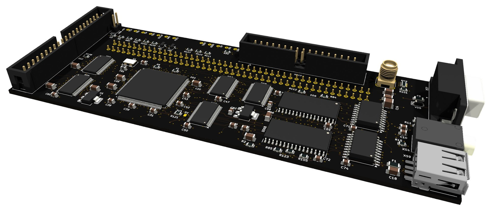
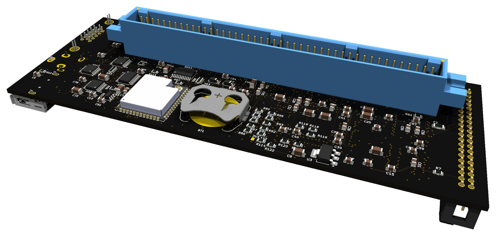

# ComboLite для «Вектора-06Ц»

ComboLite — плата расширения в разъем ВУ «Вектора-06Ц». На одной плате
собраны два квазидиска, контроллер IDE, контроллер дисковода, звук AY и ВИ53,
цветной выход VGA, USB-мышь и Wi-Fi. Логика живет в ПЛИС Lattice MachXO2,
сеть — в модуле ESP32-S3. Все детали покупаются сегодня: нет ни PLCC-84, ни
AY-3-8910, ни КР1818ВГ93.

## Что умеет

| функция | как сделано |
|---|---|
| **два квазидиска по 256 КБ** | регистры `10h` и `11h`, окна экрана и стековый режим по Баркарю. Две статики по 512 КБ на 55 нс, содержимое держит батарейка CR2032 |
| **винчестер IDE** | порты `50h`-`5Fh`, разъем на 40 контактов и питание +5 В для накопителя: CompactFlash или SD в переходнике, модуль DOM, винчестер 2,5" |
| **дисковод** | ядро, совместимое с КР1818ВГ93, порты `18h`-`1Ch`, разъем на 34 контакта, два привода. Прямой шлейф или шлейф от ПК с перекруткой — по настройке |
| **звук AY** | ядро YM2149 в ПЛИС, порты `14h` и `15h` |
| **звук ВИ53** | ПЛИС слушает записи в таймер «Вектора» (`08h`-`0Bh`) и сама синтезирует его звук: провод с контакта 42 не нужен |
| **цветной VGA** | экран «Вектора» с бордюром, 256 цветов. Палитра, бордюр, режим 512 и прокрутка снимаются с шины, мультиколор работает. 720×900 при 60 Гц (монитор с матрицей 1440×900 берет его как свой режим) или 576p при 50 Гц. Видеовыход самого «Вектора» работает как прежде |
| **USB-мышь** | розетка USB-A, мышь по протоколу KTSerg на порту `D4h`, с колесом |
| **Wi-Fi модем** | порты `28h`-`2Dh` в раскладке UART 16550, команды Hayes: telnet и TCP (BBS, IRC), Gopher, в том числе сайты на GitHub Pages через HTTPS, список BBS из Telnet BBS Guide |
| **Wi-Fi** | ESP32-S3 с внешней антенной: веб-интерфейс, винчестер как сетевой диск (NBD), образы дискет через браузер, снимок экрана «Вектора» |
| **обновление по воздуху** | и прошивка ESP, и прошивка ПЛИС заливаются по Wi-Fi, плату можно не доставать |
| **кнопки СБР и ВВОД** | плата нажимает их ключами: сама запускает «Вектор» при включении (антигудок не нужен) и по команде из веб-интерфейса |
| **подставной загрузчик** | «Вектор» со штатным ПЗУ грузится с квазидиска, винчестера или дискеты без замены ПЗУ |

Непрошитая плата «Вектору» не мешает: подтяжки держат трансляторы закрытыми,
пока ПЛИС не загрузится.

## Документы

| документ | для кого |
|---|---|
| [Руководство пользователя](doc/MANUAL.md) ([PDF](doc/MANUAL.pdf)) | подключение, веб-интерфейс, настройки, устройства, неисправности |
| [Сборка платы](doc/ASSEMBLY.md) ([PDF](doc/ASSEMBLY.pdf)) | монтаж по этапам с проверками, первая прошивка ESP и ПЛИС |
| [Программы для «Вектора»](software/README.md) | терминал, IRC, Gopher и настройки платы под МикроДОС |
| [Модем](doc/MODEM.md) | порты и команды Wi-Fi модема — для тех, кто пишет программы под него |
| [Что проверено](doc/TESTED.md) | результаты испытаний собранной платы в «Векторе» |
| [Планы](doc/ROADMAP.md) | что дорабатывается в прошивке |
| [Плата](hardware/README.md) | файлы KiCad и данные для производства |
| [ПЛИС](fpga/README.md) | исходники, проект Lattice Diamond, готовый образ |
| [Прошивка ESP](firmware/README.md) | исходники, сборка ESP-IDF |

## Как устроен VGA

Экран «Вектора» — 256×256 точек в четырех планах, 32 КБ. Хранить его копию в
ПЛИС негде, поэтому кадр не хранится, а перечитывается. Когда процессор пишет
в экранную память, та же запись ложится и в статику платы — это копия экрана.
VGA-тракт читает ее строка за строкой по ходу развертки, в паузах между
обращениями «Вектора» к памяти. В самой ПЛИС остается только кольцо на 32
строки.

ЦАП на выходе — три разряда на красный, три на зеленый и два на синий, как в
байте палитры «Вектора» (`BBGGGRRR`), поэтому на VGA те же 256 цветов. Каждую
запись в порты палитры и бордюра плата кладет в журнал вместе с местом в
строке, с точностью до такта процессора. Каждая строка воспроизводится по
своему журналу, поэтому мультиколор, в том числе со сменой палитры посреди строки,
выглядит так же, как на телевизоре.

Кадр «Вектора» — 50 Гц. Режимы VGA:

- **60 Гц** (по умолчанию) — 720×900, половина VESA 1440×900@60. Монитор с
  матрицей 1440×900 принимает его как свой режим: точка «Вектора» ложится на
  матрицу целым прямоугольником 2×3 (в режиме 256 — 4×3), без размытия, а
  картинка 512×256 занимает 1024×768, ровно 4:3. Каждый кадр VGA показывает
  целиком один кадр «Вектора»: палитра, бордюр и прокрутка из одного кадра, без
  шва; каждый шестой кадр VGA повторяет предыдущий;
- **50 Гц** — развертка 576p (31,3 кГц, 625 строк), кадры один в один с
  «Вектором». Подходит мониторам и телевизорам, которые принимают 50 Гц.

На вывод 9 разъема VGA подано +5 В через предохранитель и диод: переходники
VGA→HDMI часто питаются только от него.

## Разъемы

| | что | где |
|---|---|---|
| `XS1` | СНП34-90, в разъем ВУ «Вектора» | изнанка |
| `XS2` | IDE, 40 контактов | левый край |
| `XS11` | +5 В для привода IDE | рядом с `XS2` |
| `XS10` | дисковод, 34 контакта | верхний край |
| `XS8` | антенна Wi-Fi, RP-SMA | верхний край справа |
| `XS7` | VGA, DE-15 | правый край |
| `XS4` | звук, гнездо 3,5 мм стерео | правый край |
| `XS9` | USB-A для мыши | правый край |
| `TP10`-`TP24` | JTAG ПЛИС и UART модуля | верхняя кромка |

## Характеристики

| | |
|---|---|
| плата | 159,25 × 60,75 мм, шесть слоев |
| ПЛИС | Lattice `LCMXO2-7000HE-4TG144C`: 6641 LUT4 из 6864 и все 26 блоков памяти. Ядро на 50 МГц, VGA на 40 МГц, дисковод на 16 МГц |
| память | 2 × `AS6C4008-55`, 2 × 512 КБ: два квазидиска по 256 КБ и копия экрана |
| сеть | `ESP32-S3-WROOM-1U`, внешняя антенна |
| шина | уровни 5 В «Вектора» ↔ 3,3 В ПЛИС через пять `SN74LVC16T245` и один `SN74LVC8T245` |
| питание | +5 В от «Вектора»; на плате 3,3 В двумя стабилизаторами (логика и модуль отдельно) и 1,2 В для ядра ПЛИС |
| деталей | 171 позиция, пайка ручная; самое мелкое — TQFP-144 и TSSOP-48 с шагом 0,5 мм |

## Состав репозитория

| каталог | что |
|---|---|
| `hardware/` | схема и плата KiCad, гербер, сверловка, BOM |
| `fpga/` | исходники ПЛИС на Verilog, выводы, проект Lattice Diamond, готовый образ `combolite.jed` |
| `firmware/` | прошивка ESP32-S3 на C, ESP-IDF |
| `www/` | веб-интерфейс, уезжает в прошивку ESP |
| `tools/combo.py` | утилита для управления платой из командной строки (Python 3, без зависимостей) |
| `doc/` | документы |

## Лицензии

- Прошивки ПЛИС и ESP, веб-интерфейс, утилита — GNU GPL v3 ([LICENSE](LICENSE)).
- Плата — CERN-OHL-S v2 ([hardware/LICENSE](hardware/LICENSE)).
- Чужой код в составе — под своими условиями, список в
  [THIRD_PARTY.md](THIRD_PARTY.md).
