# ComboLite: сборка по этапам

Плата шестислойная, 159,25 × 60,75 мм. Паять **171 позицию**: 80 на лице, 91
на изнанке. Чертежи и таблицы этапов выведены из платы
`hardware/kicad/combolite2.kicad_pcb`.

Порядок собран так, чтобы каждый этап кончался проверкой и плату можно было
включить, не дожидаясь остального: питание, генератор, ESP, ПЛИС и так далее.
Номинал при этом открывается несколько раз, зато поломка ловится на том
этапе, где появилась, а не после установки всех 171 детали.

Как читать картинки этапа:

- **оранжевое** — ставится на этом этапе;
- **серое** — уже стоит с прошлых этапов;
- **красная точка** — вывод 1 микросхемы, у диода — катод;
- **красный крест** — не ставить: `C6`, `R14`, `R15`, `R108`;
- изнанка нарисована так, как ее видно, если перевернуть плату справа налево:
  разъем IDE `XS2` оказывается справа.

`TP10`-`TP24` — отверстия под крючок щупа, в них ничего не паяется. Подписи на
лице: `TCK TMS TDI TDO BLK_N GND P3V3` (JTAG ПЛИС) и `TXD0 RXD0 EN IO0 GND`
(UART модуля ESP). У `TP14` написано `BLK_N`, но это вывод `PROGRAMN` ПЛИС: в
этой плате на нем сигнал `blk_n`.

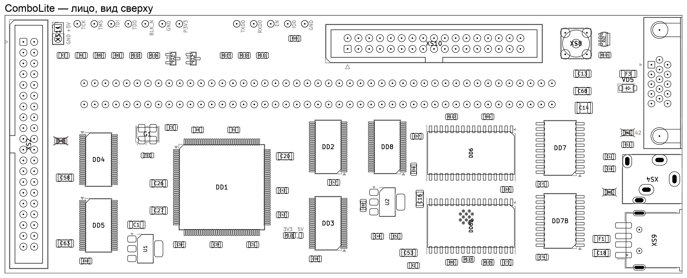

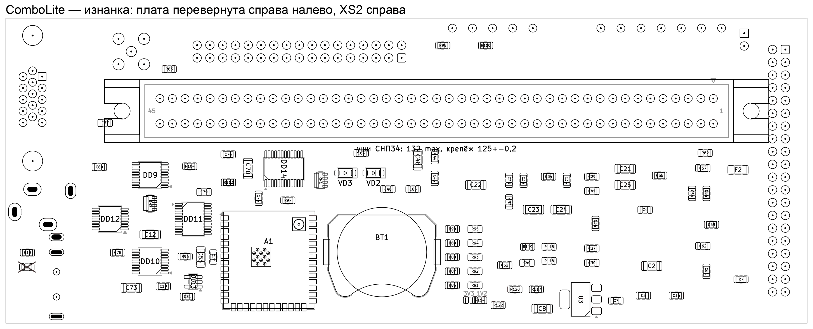

## Что подготовить

| что | зачем |
|---|---|
| детали по BOM | `hardware/production/combolite2-bom.csv`; номера DigiKey — в `hardware/production/bom-digikey.csv` |
| CR2032 | купить на месте, ставится в самом конце |
| лабораторный блок 5 В с ограничением тока | питание на столе идет через `XS11`, ток ограничивать на каждом этапе |
| мультиметр, осциллограф | напряжения этапов 1-2, генератор 50 МГц |
| Raspberry Pi | первая прошивка ESP по UART (этап 3) и один раз ПЛИС по JTAG — строка настроек (этап 4) |
| свисток USB-UART на 3,3 В с выводами DTR и RTS | необязательно: первая прошивка ESP без Raspberry |
| фен или нижний подогрев | тепловая площадка модуля `A1`, паяльником к ней не подобраться |
| три провода с крючками | перемычки `XS1` на столе, этап 9 |

Самые мелкие корпуса: `DD1` в TQFP-144 и пять `SN74LVC16T245` в TSSOP-48, все
с шагом 0,5 мм; на изнанке пять TSSOP с шагом 0,65. После каждой такой
микросхемы прозвонить соседние выводы на замыкание: перемычка из припоя под
лупой видна не всегда, а тестером слышна сразу.

**Ток записывать на каждом этапе.** Ориентир — потребление от блока 5 В:

| после этапа | ток |
|---|---|
| 1-2 | около 0,01 А |
| 3, ESP без прошивки | 0,03 А |
| 5 | 0,13 А при включении; через 6-7 с, когда ESP подключилась к Wi-Fi, — 0,19 А и держится |
| 6 | 0,21 А |
| 8 | 0,16 А при включении, через 10 с — 0,21 А |

Скачок через несколько секунд после включения — это Wi-Fi, а не повернутая
микросхема. Если напряжения этапа странные, сначала проверить уставку блока.

## 0. Голая плата

Прозвонить на землю цепи питания. На голой плате каждая должна показывать
обрыв:

| цепь | где щупать |
|---|---|
| `P5V` | пятак `C1` или `C14`, контакты 2 и 44 `XS1` |
| `P3V3` | `TP16` |
| `P3V3_ESP` | пятак `C16` |
| `P1V2` | пятак `C8` (изнанка) |
| `VBAT_RAM` | пятак `C69` или `C72` |

Заводской брак шестислойки редок, но искать его после установки ПЛИС куда
дороже, чем сейчас.

## 1. Питание

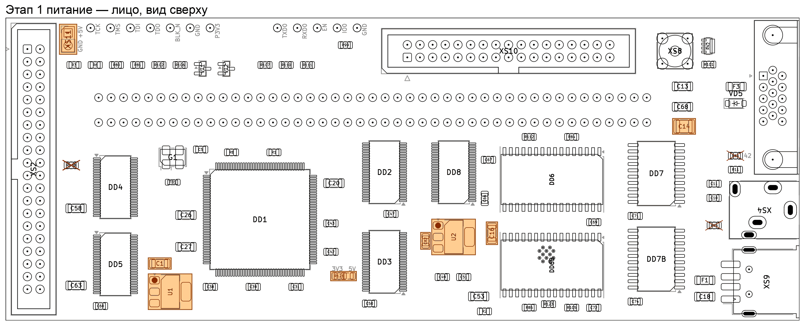

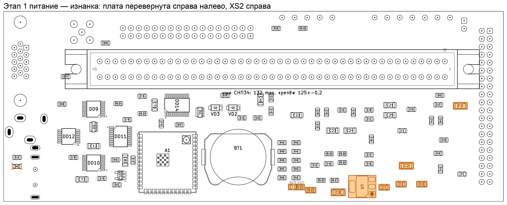

| сторона | номинал | корпус | шт | позиции |
|---|---|---|---|---|
| лицо | 0R | 0805 на 3 пятака | 1 | `R121` |
| лицо | 100nF | 0805 | 1 | `C82` |
| лицо | 100uF | 1210 | 1 | `C14` |
| лицо | 10uF | 1206 | 1 | `C1` |
| лицо | 22uF | 1206 | 1 | `C16` |
| лицо | LD1117S33TR | SOT-223 | 2 | `U1`, `U2` |
| лицо | питание IDE 5В | штыри 1×2 | 1 | `XS11` |
| изнанка | 0R | 0805 на 3 пятака | 1 | `R114` |
| изнанка | 100nF | 0805 | 3 | `C7`, `C3`, `C15` |
| изнанка | 120R | 0805 | 1 | `R122` |
| изнанка | 22uF | 1206 | 2 | `C8`, `C2` |
| изнанка | LD1117S12TR | SOT-223 | 1 | `U3` |
| изнанка | MF-NSMF110-2 | 1206 | 1 | `F2` |

> [!CAUTION]
> **`R114` — на пятаки 1-2, у подписи «1V2».** Это питание ядра. У сорта HE ядро
> держит до 1,32 В (FPGA-DS-02056, табл. 3.1-3.2), и на пятаках 2-3 («3V3») ПЛИС
> сгорит при первом включении. Пятаки 2-3 только для сорта HC.

**`R121` — на пятаки 1-2, у подписи «3V3».** Это сторона B трансляторов;
пятаки 2-3 («5V») выводят трансляторы за пределы паспорта.

**`R122` ставить обязательно:** без нагрузки `LD1117` на 1,2 В не держит
выход (ST DocID2572, рис. 3).

**`XS11` ставится сейчас**, через него плата питается на столе: квадратный
пятак `+5V`, второй `GND`. Путь `XS11` → `F2` → `P5V`.

**Проверка.** Блок 5,0 В, ограничение 100 мА, подать на `XS11`.

| что | где | норма |
|---|---|---|
| `P5V` | `C1` | 5,0 В |
| `P3V3`, выход `U1` | `TP16` | 3,3 В |
| `P3V3_ESP`, выход `U2` | `C16` | 3,3 В |
| `P1V2`, выход `U3` | `C8` | 1,188-1,212 В (ST DocID2572, табл. 4, нагрузка 10 мА — это и есть `R122`) |
| питание ядра | **средний пятак `R114`** | 1,2 В. Если 3,3 В — `R114` стоит не на тех пятаках, переставить ДО ПЛИС |
| сторона B трансляторов | средний пятак `R121` | 3,3 В, не 5 |
| ток | блок | десятки миллиампер; `R122` сама берет 10 мА. Ничего не греется |

Пока это не так, дальше идти незачем.

## 2. Генератор

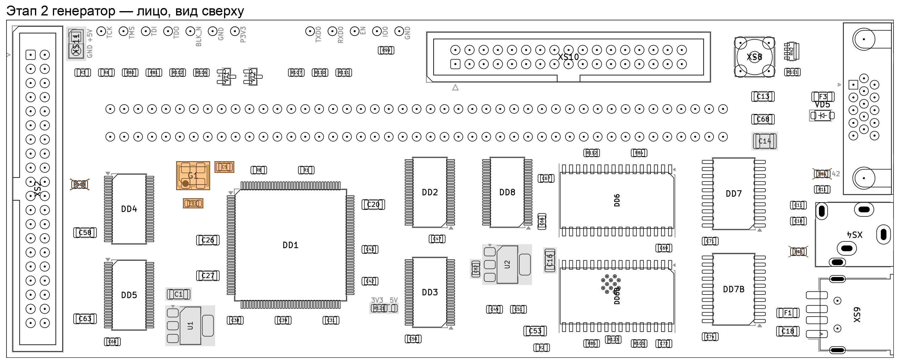

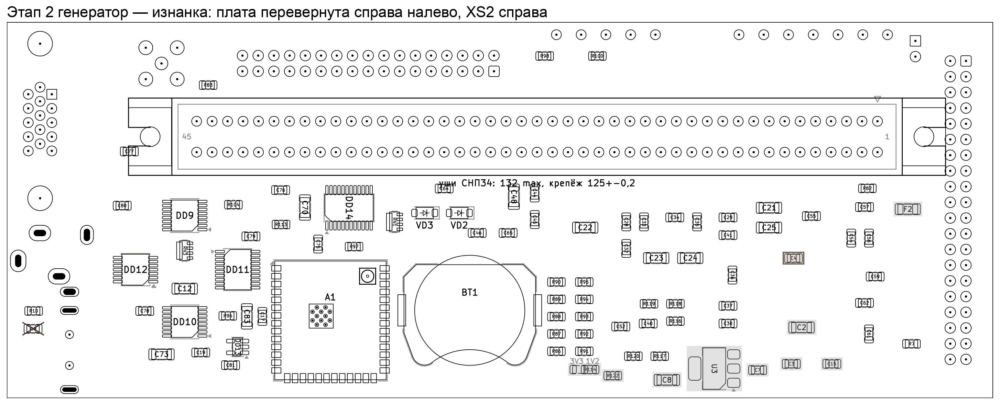

| сторона | номинал | корпус | шт | позиции |
|---|---|---|---|---|
| лицо | 100nF | 0805 | 1 | `C5` |
| лицо | 50.000MHz 3.3V | 5032 | 1 | `G1` |
| лицо | 600R@100MHz | 0805 | 1 | `FB1` |
| изнанка | 1uF | 0805 | 1 | `C4` |

**`G1`: вывод 1 — левый нижний на чертеже.** Срезанный угол есть только на
нижней стороне корпуса, у выводов; на крышке с маркировкой ключа нет
(даташит `ECS-5032MV`, Figure 1). Выводы 1 и 4 оба на питании, 2 на земле,
3 — выход к `DD1`.

> [!CAUTION]
> Поворот `G1` на 180° меняет местами питание и землю, генератор этого не
> переживет. Проверьте срез на нижней стороне корпуса до пайки.

**Проверка.** `P3V3_OSC` на `C5` — 3,3 В. На выводе 3 `G1` — 50 МГц размахом
около 3,3 В. На `DS1054Z` это будет почти синус: третья гармоника лежит на
150 МГц, за полосой прибора. Смотреть на частоту и размах.

## 3. ESP

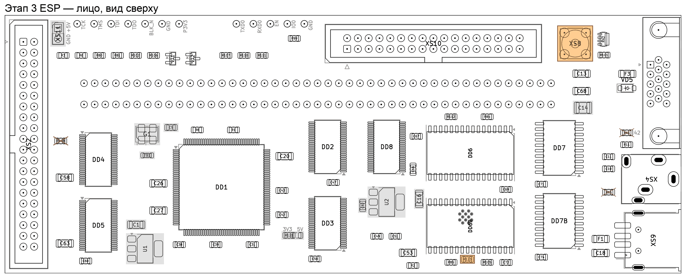

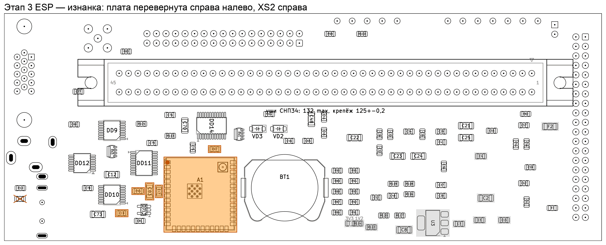

| сторона | номинал | корпус | шт | позиции |
|---|---|---|---|---|
| лицо | 68R | 0805 | 1 | `R123` |
| лицо | RP-SMA | RP-SMA | 1 | `XS8` |
| изнанка | 100nF | 0805 | 1 | `C17` |
| изнанка | 10k | 0805 | 2 | `R96`, `R97` |
| изнанка | 1uF | 0805 | 1 | `C19` |
| изнанка | 22uF | 1206 | 1 | `C83` |
| изнанка | ESP32-S3-WROOM-1U | модуль | 1 | `A1` |

> [!WARNING]
> **`A1` ставится до `DD6B`.**

Двенадцать отверстий тепловой площадки модуля
выходят на лицо под корпус `DD6B`, в 0,96 мм от его выводов 8-11. Со стороны
лица они под маской, но припой с площадки может пройти насквозь. Пасты на
площадку класть умеренно, паять феном или на подогреве. После пайки осмотреть
на лице место под `DD6B`: там не должно быть выпуклостей припоя.

`R96` с `C19` — задержка сброса модуля, 10 мс; `R97` держит `IO0` вверху.
`R123` 68 Ом стоит на `SCK` у вывода 20 модуля.

**Антенна.** Гнездо на плате и гнездо пигтейла не стыкуются, поэтому кабель
припаивается к `XS8`. У кабеля `2015699-1`
срезать одну вилку, останется около 95 мм. Центральную жилу — на центральный
вывод `XS8`, оплетку — на его корпус, со стороны изнанки, где модуль. Вторую
вилку — на U.FL модуля. Антенну вкрутить до первой прошивки: прошивка платы
работает по Wi-Fi.

**Первая прошивка ESP — по UART Raspberry Pi.** Провода от гребенки Raspberry
к отверстиям у верхнего края платы (подписаны `TXD0 RXD0 EN IO0 GND`):

| Raspberry | плата |
|---|---|
| вывод 8, GPIO14 (TXD) | `TP21` (`RXD0`) |
| вывод 10, GPIO15 (RXD) | `TP20` (`TXD0`) |
| вывод 6, GND | `TP24` |
| — | `TP23` (`IO0`) перемычкой на `TP24` |

Вывод 3,3 В Raspberry к плате не подключать: плата питается от блока через
`XS11`, ограничение 500 мА, в передаче модуль берет сотни миллиампер. DTR и RTS
у Raspberry нет, поэтому в загрузку модуль вводится руками: перемычка `IO0` на
землю, потом питание. После прошивки перемычку снять и включить питание
заново.

На Raspberry один раз: UART на GPIO14/15 включить, консоль с него снять
(`/boot/firmware/config.txt`: `enable_uart=1`, `dtoverlay=disable-bt`; из
`cmdline.txt` убрать `console=serial0,...`), перезагрузить. `esptool` ставить
из pip в отдельное окружение: у пакета из apt нет заглушек для ESP32-S3.

Прошивка собирается из `firmware/esp32`, ESP-IDF 5.3.1
([firmware/README.md](../firmware/README.md)):

    cd firmware/esp32
    idf.py set-target esp32s3
    idf.py build

Образы из `build-s3` скопировать на Raspberry и залить `esptool` на
`/dev/ttyAMA0` с теми адресами, что сборка печатает в конце.
`COMBO_FAKE_DRIVE` должен быть выключен, по умолчанию он выключен.

Свисток USB-UART с DTR и RTS подойдет так же: TX на `TP21`, RX на `TP20`,
DTR на `TP23`, RTS на `TP22`, GND на `TP24`. Тогда `esptool` вводит модуль в
загрузку сам, перемычка не нужна.

**Сеть.** Если прошивка не находит знакомую сеть, ESP поднимает свою точку
`combolite-XXXX`. С телефона или компьютера подключиться к ней, открыть
`http://192.168.4.1/`, выбрать домашнюю сеть. Там же один раз показывается
секрет платы — сохранить его сразу, потом его можно узнать только по проводу.

**Проверка.** В журнале ESP «нет ответа от ПЛИС» — так и должно быть, ПЛИС еще
нет. Веб-интерфейс открывается по сети. Для `tools/combo.py` дальше нужны
`COMBO_SECRET` (секрет) и `COMBO_HOST`, если адрес не `192.168.1.2`.

## 4. ПЛИС

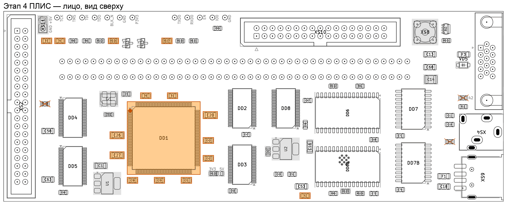

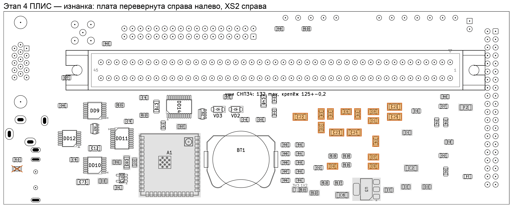

| сторона | номинал | корпус | шт | позиции |
|---|---|---|---|---|
| лицо | 100k | 0805 | 1 | `R8` |
| лицо | 100nF | 0805 | 5 | `C38`, `C39`, `C31`, `C43`, `C42` |
| лицо | 10uF | 1206 | 3 | `C26`, `C27`, `C20` |
| лицо | 1k | 0805 | 1 | `R1` |
| лицо | 2k2 | 0805 | 1 | `R6` |
| лицо | 4k7 | 0805 | 4 | `R3`, `R106`, `R107`, `R2` |
| лицо | LCMXO2-7000HE-4TG144C | TQFP-144, 0,5 | 1 | `DD1` |
| изнанка | 100nF | 0805 | 11 | `C28`, `C32`, `C33`, `C40`, `C34`, `C35`, `C29`, `C41`, `C37`, `C30`, `C36` |
| изнанка | 10uF | 1206 | 5 | `C22`, `C23`, `C24`, `C21`, `C25` |

> [!CAUTION]
> **Перед `DD1` еще раз померить средний пятак `R114`: 1,2 В.** Если там
> 3,3 В, ПЛИС сгорит при первом включении.

`DD1`: вывод 1 — левый верхний угол. После пайки прозвонить соседние выводы
по всем четырем сторонам.

**Прошивка: первый раз — по JTAG с Raspberry Pi, дальше — с ESP по SSPI.**
Образ — `fpga/bitstream/combolite.jed` ([fpga/README.md](../fpga/README.md)).

У чистой ПЛИС строка настроек (feature row) нулевая, а в образе в ней
выключен порт SDM и выводы `DONE`, `INITN`, `PROGRAMN` отданы под логику. ESP
по SSPI пишет только флеш конфигурации, строку настроек не трогает, и на чистый
кристалл отвечает отказом 409. С `--force` образ ляжет, но строка останется
заводской: `SRAM_CE0_N` (на выводе `DONE`) и `blk_n` (на `PROGRAMN`) работать
не будут. Поэтому один раз образ пишется по JTAG — `openFPGALoader` пишет и
строку настроек.

1. `python3 tools/combo.py fpga --detect` — IDCODE `0x012b5043`, это
   LCMXO2-7000HE. Значит, SSPI жив.
2. JTAG с Raspberry Pi на `TP10`-`TP13`, земля `TP15`. `TP16` (`P3V3`) не
   подключать, Raspberry питается сама:

       openFPGALoader -c libgpiod --pins=22:23:17:27 -f --verify combolite.jed

   Порядок в `--pins` — TDI:TDO:TCK:TMS, номера GPIO Raspberry: TDI — 22,
   TDO — 23, TCK — 17, TMS — 27. В
   выводе должно быть `Program features Row: DONE`, около 30 с.
3. Проверка пути через ESP: `python3 tools/combo.py fpga fpga/bitstream/combolite.jed`
   **без** `--force` — проходит за 23-27 с (стирание, запись, постраничная
   сверка). Если снова 409, строка настроек в файле другая: разобраться, а не
   давить `--force`.
4. `fpga --detect` показывает `done`. `XLAT_OE_N` ушел вниз: щупать `R6`
   вывод 1, вывод 2 сидит на 3,3 В.
5. **Один раз выключить и включить питание:** `done` поднимается сам. Это
   единственная проверка, что образ лег во флеш, а не только в SRAM.

Дальше ПЛИС обновляется только с ESP. Если заливка сорвалась (обрыв Wi-Fi,
«the FPGA stayed busy»), сразу повторить `combo.py fpga` нельзя: ESP держит
образ в памяти для повтора, и новая загрузка падает с 503 out of memory.
Подождать пять минут или перезапустить ESP (`combo.py reboot`).

Если ПЛИС загрузила испорченный образ и не отвечает: замкнуть `TP14` на землю
(`TP15`) и включить питание — образ из флеша не загрузится, и ее можно
прошить заново.

## 5. Трансляторы

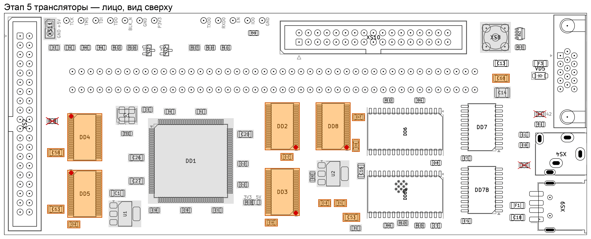

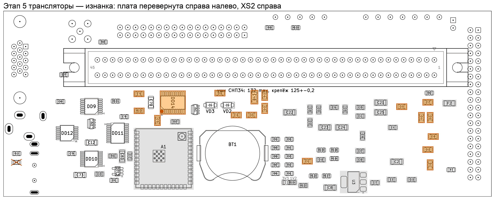

| сторона | номинал | корпус | шт | позиции |
|---|---|---|---|---|
| лицо | 100nF | 0805 | 7 | `C60`, `C50`, `C47`, `C49`, `C51`, `C66`, `C67` |
| лицо | 10uF | 1206 | 4 | `C58`, `C63`, `C53`, `C68` |
| лицо | SN74LVC16T245 | TSSOP-48, 0,5 | 5 | `DD4`, `DD5`, `DD2`, `DD3`, `DD8` |
| изнанка | 100nF | 0805 | 15 | `C76`, `C75`, `C64`, `C46`, `C65`, `C44`, `C45`, `C52`, `C55`, `C54`, `C57`, `C62`, `C56`, `C61`, `C59` |
| изнанка | 10uF | 1206 | 1 | `C48` |
| изнанка | 2k2 | 0805 | 1 | `R113` |
| изнанка | SN74LVC8T245PWR | TSSOP-24, 0,65 | 1 | `DD14` |

> [!CAUTION]
> **Пять одинаковых трансляторов стоят не одинаково.** У `DD4` и `DD5` вывод 1
> левый верхний, у `DD2`, `DD3` и `DD8` — правый нижний, они повернуты на 180°.
> Ставить группами по ориентации: сперва `DD4` и `DD5`, потом остальные три.

Разворот прозвонкой питания не ловится: у четырех из пяти обе стороны на
3,3 В. Ловится выводом разрешения. **После пайки каждого `SN74LVC16T245`**
прозвонить его вывод 48 (считать по метке на корпусе) с выводом 1 `R6`: должно
быть 0 Ом, это `XLAT_OE_N`. У `DD14` то же самое: вывод 22 с выводом 1 `R113`.

`DD14` на изнанке: вывод 1 — левый нижний на картинке изнанки.

**Проверка.** Ток вырос, ничего не греется, `XLAT_OE_N` по-прежнему внизу.

## 6. Память и счетчики

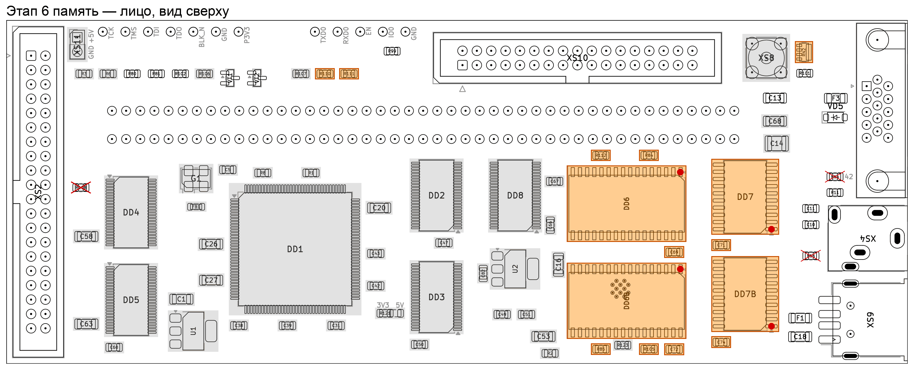

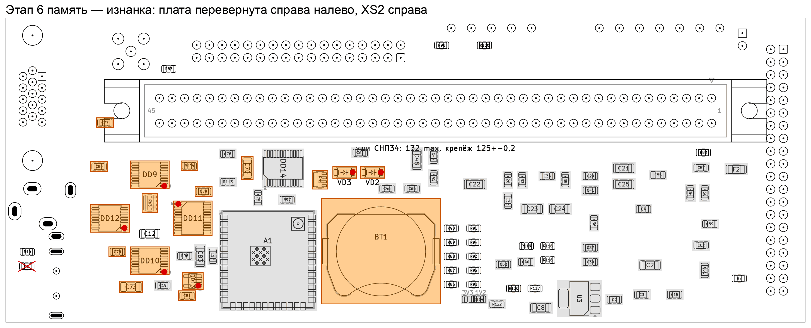

| сторона | номинал | корпус | шт | позиции |
|---|---|---|---|---|
| лицо | 100k | 0805 | 3 | `R85`, `R84`, `R105` |
| лицо | 100k | 4×0603 | 1 | `RN2` |
| лицо | 100nF | 0805 | 4 | `C69`, `C72`, `C71`, `C74` |
| лицо | 10k | 0805 | 1 | `R110` |
| лицо | 1k | 0805 | 1 | `R112` |
| лицо | 2k2 | 0805 | 1 | `R111` |
| лицо | 74AHCT574 | SOIC-20W, 1,27 | 2 | `DD7`, `DD7B` |
| лицо | AS6C4008-55ZIN | TSOP-II-32, 1,27 | 2 | `DD6`, `DD6B` |
| изнанка | 100k | 4×0603 | 2 | `RN3`, `RN1` |
| изнанка | 100k | 0805 | 1 | `R104` |
| изнанка | 100nF | 0805 | 5 | `C80`, `C77`, `C78`, `C81`, `C79` |
| изнанка | 10uF | 1206 | 2 | `C73`, `C70` |
| изнанка | 1N4148W-7-F | SOD-123 | 1 | `VD3` |
| изнанка | 74HC590PW | TSSOP-16, 0,65 | 2 | `DD9`, `DD10` |
| изнанка | BAT54W-E3-08 | SOD-123 | 1 | `VD2` |
| изнанка | CR2032 | держатель | 1 | `BT1` |
| изнанка | SN74AHCT04PWR | TSSOP-14, 0,65 | 1 | `DD12` |
| изнанка | SN74AHCT1G08DBVR | SOT-23-5 | 1 | `DD13` |
| изнанка | SN74AHCT540PWR | TSSOP-20, 0,65 | 1 | `DD11` |

Вывод 1 на картинках: `DD6`, `DD6B` — правый верхний (корпус лежит на боку),
`DD7`, `DD7B` — правый нижний. На изнанке `DD9`, `DD10`, `DD12`, `DD13` —
правый нижний, `DD11` — левый верхний.

> [!WARNING]
> **`VD2` и `VD3`: полоса на корпусе (катод) — к полосе на шелкографии**, на
> картинке изнанки катод справа. Любой из двух наоборот — статика без питания
> или без хранения.

`BT1` — пока только держатель, элемент в самом конце.

Под `DD6B` еще раз взглянуть на отверстия тепловой площадки `A1` (этап 3).

**Проверка.** `VBAT_RAM` на `C69` — чуть ниже 5 В: питание идет с `P5V` через
диод Шоттки `VD2`.

## 7. Разъемы и периферия

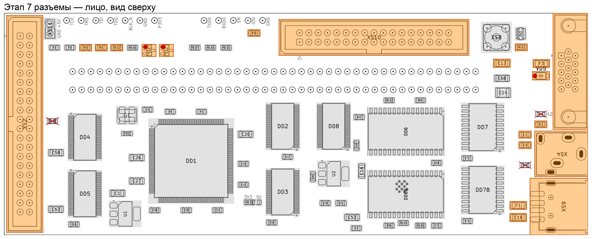

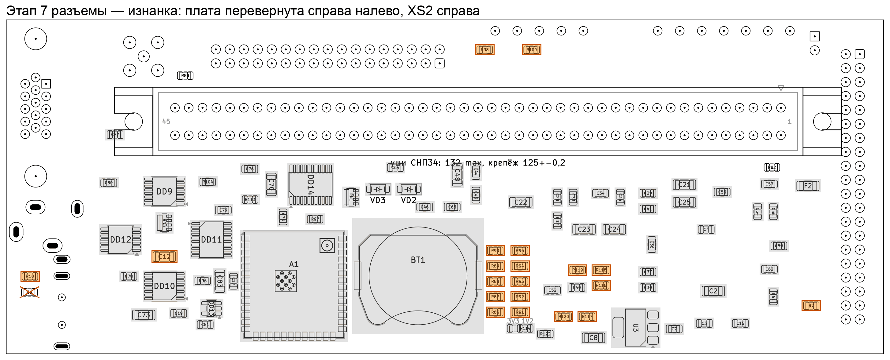

Сначала мелочь, потом выводные разъемы.

| сторона | номинал | корпус | шт | позиции |
|---|---|---|---|---|
| лицо | 100k | 0805 | 2 | `R80`, `R81` |
| лицо | 10k | 0805 | 1 | `R11` |
| лицо | 10uF | 1206 | 2 | `C13`, `C18` |
| лицо | 1k | 0805 | 3 | `R102`, `R99`, `R101` |
| лицо | 1nF | 0805 | 2 | `C11`, `C10` |
| лицо | 500mA | 1206 | 1 | `F1` |
| лицо | BSS138 | SOT-23 | 2 | `VT1`, `VT2` |
| лицо | MBR0540T1G | SOD-123 | 1 | `VD5` |
| лицо | MF-NSMF020-2 | 1206 | 1 | `F3` |
| изнанка | 10k | 0805 | 2 | `R10`, `R7` |
| изнанка | 10uF | 1206 | 1 | `C12` |
| изнанка | 1k | 0805 | 7 | `R98`, `R100`, `R120`, `R119`, `R117`, `R118`, `R116` |
| изнанка | 1k96 | 0805 | 2 | `R88`, `R91` |
| изнанка | 422R | 0805 | 1 | `R92` |
| изнанка | 487R | 0805 | 2 | `R89`, `R86` |
| изнанка | 68R | 0805 | 2 | `R95`, `R94` |
| изнанка | 845R | 0805 | 1 | `R93` |
| изнанка | 976R | 0805 | 2 | `R90`, `R87` |
| лицо | 3.5 мм стерео | гнездо 3,5 мм | 1 | `XS4` |
| лицо | DE-15 HD | DE-15 | 1 | `XS7` |
| лицо | IDC-34 | вилка 2×17 | 1 | `XS10` |
| лицо | IDE | вилка 2×20 | 1 | `XS2` |
| лицо | USB-A | USB-A | 1 | `XS9` |

**Лесенка VGA `R86`-`R95` на изнанке**: шесть разных номиналов в одной грядке
(487, 976, 1k96, 422, 845, 68). Каждый номинал — отдельный проход, сверяясь с
таблицей.

`VD5`: катод — левый вывод на лице. `XS2`: штырь 20 — ключ ATA. Если на шлейфе
отверстие 20 заглушено, штырь удалить; `R108` не ставить. `XS10` и `XS2`:
вывод 1 — квадратный пятак.

**Проверка.** `USB_VBUS` на `C18` — 5 В. На выводе 9 `XS7` — около 5 В за
`F3` и `VD5`.

## 8. `XS1`

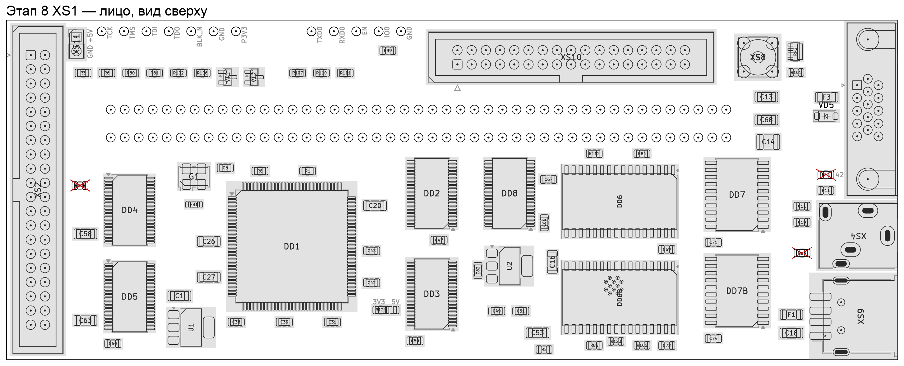

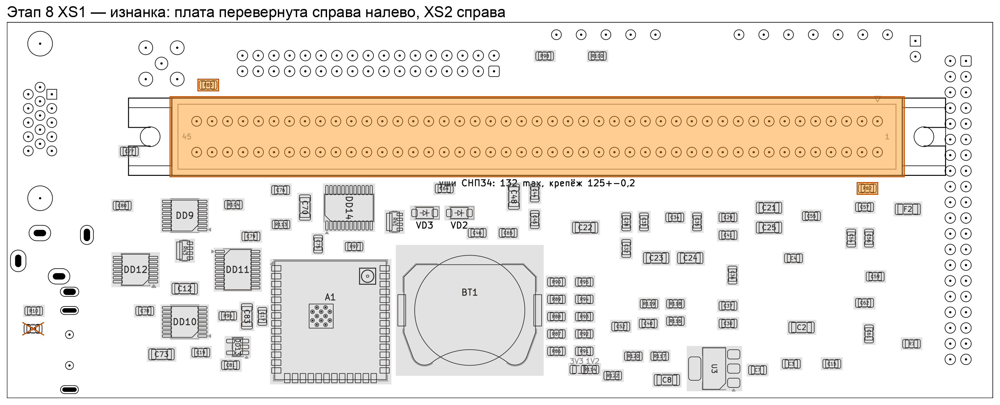

| сторона | номинал | корпус | шт | позиции |
|---|---|---|---|---|
| изнанка | 10k | 0805 | 2 | `R83`, `R82` |
| изнанка | СНП34С-90В | СНП34-90 | 1 | `XS1` |

Сперва `R82` и `R83`: они рядом с разъемом, после него к ним не подлезть.

> [!CAUTION]
> **`XS1`: вывод 1 — у треугольника и «1» на шелкографии изнанки.** 90 пятаков
> симметричны, вилку можно впаять развернутой.

Крепеж подписан там же: `уши СНП34: 132 max, крепеж 125 ± 0,2`.

`XS1` последний: с ним плата уже не ложится ровно на стол.

## 9. Проверка на столе

Вне «Вектора» нужны три перемычки на `XS1` к контакту **44** (`P5V`):

| контакт | сигнал | без перемычки |
|---|---|---|
| 41 | `~СБРОС` | удаленная часть ПЛИС в вечном сбросе, ESP получает «нет ответа от ПЛИС» |
| 35 | `~ЧТВВ` | ПЛИС видит непрерывное чтение портов, состояние привода скачет |
| 37 | `~ЗПВВ` | то же для записи, запись из веб-интерфейса ждет тишины и не проходит |

Подтяжек на этих входах нет ни на плате, ни в ПЛИС: их роль играет сам
«Вектор».

> [!CAUTION]
> **Перед перемычкой 41 → 44 прозвонить контакт 41 на землю.** Норма —
> десятки мегаом. Если там единицы ом, цепь `~СБРОС` замкнута на землю
> (вероятнее всего — перемычка из припоя на выводах транслятора `DD2`), и
> перемычка 41 → 44 закоротит блок питания.

Признак, что перемычки помогли: вместо `no answer from the FPGA over SPI` в
журнале ESP появляется `drive not responding (drive kept BSY)`.

Здесь же — первые проверки узлов:

1. мышь в `XS9`: ESP опознает ее, `combo.py board` пишет, что мышь есть;
2. удержание ВВОДа при включении: прошивка продлевает его, пока сбрасывает
   привод, не дольше 10 с.

> [!CAUTION]
> **Перед установкой в «Вектор» перемычки снять.** В нем `~СБРОС`, `~ЧТВВ` и
> `~ЗПВВ` ведет он сам, и перемычка к питанию заставит его выход работать в
> замыкание.

При возврате на стол — поставить снова, иначе плата притворится мертвой.

## 10. В «Векторе»

1. Перемычки сняты. Плата в разъеме, «Вектор» включается и грузится как без нее.
2. Картинка на VGA, 720×900 при 60 Гц (по умолчанию; монитор с матрицей
   1440×900 берет его как свой режим). Если монитор пишет «вне диапазона»,
   переключить на 576p: `python3 tools/combo.py set vga=50`. Если картинка
   смещена или размыта, нажать на мониторе автоподстройку.
3. Квазидиск: тест расширений Баркаря `kdadrtst` (И. Городецкий, картотека
   «Базис», ware/918) печатает таблицу из семи строк без ошибок.
4. Снимок экрана: `python3 tools/combo.py screen shot.png`.
5. Привод на `XS2`, дисковод на `XS10`, звук на `XS4`. Шлейф дисковода: прямой
   или от ПК с перекруткой — выставить соответствующий режим («шлейф
   дисковода», [MANUAL.md](MANUAL.md), «Дисковод»).
6. **В конце — элемент CR2032 в `BT1`.** Без питания платы `VBAT_RAM` на `C69`
   должен показать напряжение элемента минус падение на `VD3`.

## Если не пошло

- напряжения этапа странные — сначала проверить уставку и ограничение тока
  лабораторного блока;
- ПЛИС не отвечает модулю — этап 4: `fpga --detect`, прозвонка выводов `DD1`;
- плата в «Векторе» молчит — перемычки `XS1` сняты? на столе они нужны, в
  «Векторе» — нет;
- остальное — раздел «Если что-то не работает» в [MANUAL.md](MANUAL.md).
