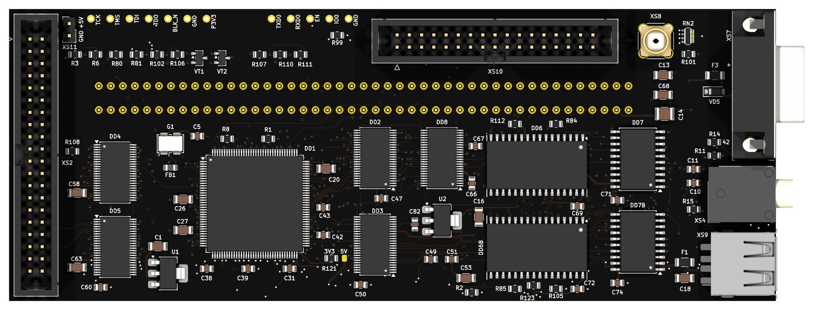
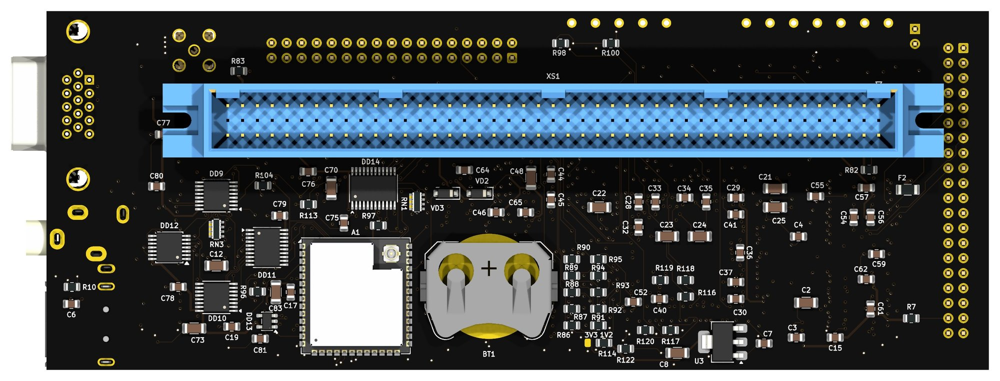

# ComboLite: руководство пользователя

ComboLite — плата расширения в разъем ВУ «Вектора-06Ц». На ней два
квазидиска, контроллер винчестера, контроллер дисковода, звук AY и ВИ53,
цветной выход VGA, USB-мышь и Wi-Fi с веб-интерфейсом. Это руководство — о
том, как плату поставить, настроить и чем она полезна каждый день. Как плата
устроена, рассказано в [README](../README.md), как собрать — в
[ASSEMBLY.md](ASSEMBLY.md), что проверено — в [TESTED.md](TESTED.md).

## Что понадобится

| что | зачем | обязательно |
|---|---|---|
| «Вектор-06Ц» | плата питается от него, своего питания у нее нет | да |
| CompactFlash или SD-карта с переходником на IDE, модуль DOM или винчестер IDE 2,5" | диск, размеченный на дискеты | для винчестера |
| привод 3,5" или 5,25", Gotek | дисковод | для дисковода |
| монитор VGA или переходник VGA→HDMI | картинка «Вектора» | для VGA |
| USB-мышь, проводная или с радиоприемником | мышь в программах, которые ее знают | нет |
| Wi-Fi 2,4 ГГц и компьютер или телефон с браузером | веб-интерфейс, обновления | для сети |
| батарейка CR2032 | хранит содержимое квазидисков без питания | нет |

## Установка

> [!CAUTION]
> Все подключения делать при выключенном «Векторе».

| разъем | что подключать | замечания |
|---|---|---|
| `XS1` | разъем ВУ «Вектора» | вилка СНП34-90 на изнанке |
| `XS2` | накопитель IDE: переходник CompactFlash или SD, модуль DOM, винчестер | 40 контактов. Штырь 20 по умолчанию ни к чему не подключен, см. «Питание» в разделе «Винчестер» |
| `XS11` | питание накопителя | +5 В — квадратный пятак, второй — земля. Через предохранитель на 1,1 А |
| `XS10` | шлейф дисковода | 34 контакта, до двух приводов, см. «Дисковод» |
| `XS7` | монитор VGA | на выводе 9 есть +5 В: от него питаются переходники VGA→HDMI |
| `XS4` | звук | гнездо 3,5 мм, стерео |
| `XS9` | USB-мышь | только мышь, другие USB-устройства плата не понимает |
| `XS8` | антенна Wi-Fi | разъем RP-SMA. Антенна с обычным SMA вкрутится, но связи не даст |
| `BT1` | элемент CR2032 | плюсом к лепесткам держателя |

Чего плате **не нужно**: +12 В в «Векторе», провода с контакта 42, доработки
«антигудок», замены ПЗУ. Непрошитая ПЛИС «Вектору» не мешает:
трансляторы шины остаются закрытыми.

## Первое включение

После включения «Вектор» секунду-другую стоит, потом грузится: плата держит
клавишу ВВОД, пока винчестер проходит сброс (не дольше 10 с), и отпускает ее.
Дальше «Вектор» грузится из своего ПЗУ как обычно. С винчестера он грузится,
если ПЗУ это умеет; со штатным ПЗУ — через подставной загрузчик (см. раздел о запуске
«Вектора»).

Выход самого «Вектора» на телевизор работает как прежде. Одновременно картинка
идет на VGA.

## Сеть

### Первая настройка

Новая плата своей сети не знает и поднимает собственную точку доступа:

1. На телефоне или компьютере найдите сеть `combolite-XXXX` (XXXX — четыре
   шестнадцатеричные цифры, у каждой платы свои). Она открытая, без пароля.
2. Откройте в браузере `http://192.168.4.1/`. Появится страница «Настройка
   платы».
3. **Запишите секрет платы.** Он показывается на этой странице только при
   самой первой настройке и нужен потом для входа. Если его не записать,
   узнать его можно только по проводу (см. «Если что-то не работает»).
4. Выберите свою сеть в списке, введите пароль и нажмите «Подключиться».
   Список отсортирован по силе сигнала; кнопка «посмотреть ещё раз» обновляет
   его. Скрытые сети в список не попадают.
5. Плата перезагрузится и подключится к вашей сети. Страница на 192.168.4.1
   перестанет отвечать — так и должно быть.

Если подключиться не удалось (неверный пароль, сеть далеко), через 30 секунд
плата снова поднимет свою точку доступа.

### Адрес платы

Адрес плата получает от роутера. Найдите новое устройство в списке клиентов
роутера и откройте его адрес в браузере. Удобно закрепить за платой
постоянный адрес в настройках роутера.

### Вход

При первом открытии веб-интерфейс спрашивает секрет. Он вводится один раз:
браузер хранит производный ключ до закрытия вкладки, сам секрет нигде не
сохраняется. После перезагрузки платы (например, после обновления) войти
придется снова.

> [!CAUTION]
> Плату нельзя выставлять в интернет: веб-интерфейс рассчитан на домашнюю
> сеть.

### Сменить сеть

Щелкните значок сигнала в шапке и нажмите «забыть сеть», а затем еще раз —
«ещё раз — плата уйдёт из сети». То же делает команда
`python3 tools/combo.py forget --yes` с компьютера (см. «combo.py»). Плата
забудет сеть, перезагрузится и снова поднимет точку доступа `combolite-XXXX`;
дальше — как при первой настройке, с телефона или ноутбука рядом. Секрет при
этом не меняется.

## Веб-интерфейс

В шапке веб-интерфейса:

| значок | что показывает |
|---|---|
| «привод …» | готов, в сбросе или не отвечает; по щелчку — модель, серийный номер, объем и кнопка «сбросить привод» |
| «„Вектор“ трогал диск» | «Вектор» обращался к винчестеру, показанное могло устареть; щелчок перечитывает диски |
| только чтение | плата прошита так, что запись с веб-интерфейса запрещена |
| плата | устройства на шине, настройки, клавиши «Вектора», загрузчик, экран |
| уровень сигнала, дБм | зеленый — хорошо, желтый — от −75 до −65, красный — хуже −75; по щелчку «эфир», «журнал» и «забыть сеть» |
| «в раздаче: …» | вышла другая прошивка ESP или ПЛИС, см. «Обновление прошивок» |
| ? | краткая справка «Что здесь умеют» |

Есть светлая и темная тема и два языка, русский и английский. Сообщения самой
платы в журнале — на английском.

## Винчестер

### Какой нужен

Подходит любой накопитель IDE на 5 В, один, в режиме master:

- карта CompactFlash в переходнике на IDE — проверена SAMSUNG CF/ATA;
- карта SD в переходнике на IDE;
- модуль DOM, который вставляется прямо в разъем;
- винчестер 2,5" через переходник с 44 контактов на 40 и питание.

Винчестеру 3,5" нужно еще +12 В, на плате их нет.

«Вектор» видит контроллер на портах `50h`-`58h`, МикроДОС с него грузится.

**Питание.** Сорокаконтактный разъем IDE питания не несет, его берут с `XS11`
отдельным проводом. Предохранитель на 1,1 А рассчитан и на 2,5-дюймовый
винчестер, которому при раскрутке нужно около ампера.

**Контакт 20.** По стандарту ATA это ключ: у шлейфа отверстие 20 обычно
заглушено, у накопителей контакта 20 нет. На плате штырь 20 стоит, но по
умолчанию ни к чему не подключен: перемычка `R108` не запаяна.

Питание на контакт 20 нужно только модулям DOM, которые питаются через него
(их помечают буквой R). Такой модуль вставляют прямо в `XS2` и либо тянут от
него провод к `XS11`, либо запаивают `R108` (0 Ом) — тогда на контакт 20
приходит +5 В.

> [!CAUTION]
> С перемычкой `R108` нельзя ставить шлейф или устройство, у которых контакт 20
> посажен на землю: будет замыкание.

Если шлейф с заглушенным отверстием 20 не надевается, штырь 20 можно удалить.
Тогда DOM с питанием по контакту 20 придется питать проводом от `XS11`.

### Как устроен диск

Диск размечен на дискеты по 780 КБ данных. Сколько их, записано в заголовке
диска, и обычно это зависит от объема: на карту около 250 МБ помещается 324.
Номера дискет в веб-интерфейсе шестнадцатеричные. Это та же разметка, с
которой работает программа HDIR на «Векторе». У дискеты может быть метка до 32 символов в КОИ-8. Внутри
дискеты — файловая система CP/M: имена 8.3 латиницей, области пользователей.

### Новая карта

Если на карте нет разметки, веб-интерфейс вместо дискет показывает «Карта не
размечена на дискеты» и предлагает разметить ее. Число дискет можно уменьшить
(по умолчанию — сколько влезает). Кнопка «разметить карту» срабатывает со
второго нажатия: плата пишет в заголовок геометрию привода и число дискет и
очищает их каталоги, системную область не трогает. Это то же, что делают
`INITHDD6` и `FRMTHDD6` на «Векторе». Уже размеченную карту из веб-интерфейса
переразметить нельзя.

Разметить можно и на самом «Векторе», программами из набора ImproverX
[TESTHDD-for-Vector06c](https://github.com/ImproverX/TESTHDD-for-Vector06c)
(готовые `.COM` — в папке `BIN`, лицензия GPL-2.0). Они работают в МикроДОС
с тем же контроллером, что у платы (порты `50h`-`57h`):

1. `TESTHDD6` проверяет контроллер и карту. Начинают с него.
2. `INITHDD6` записывает на карту ее геометрию и число дискет.
3. `FRMTHDD6` очищает каталоги дискет. После этого веб-интерфейс видит
   дискеты пустыми.

На неразмеченную карту программы положить некуда, поэтому их запускают с
дискеты или с другой, уже размеченной карты.

Число дискет выбирают в `INITHDD6`. Веб-интерфейс при открытии читает каталоги
всех дискет: 324 читаются за несколько секунд, а чем больше дискет, тем
дольше.

### Дискеты в браузере

При открытии веб-интерфейс читает каталоги всех дискет, это занимает
несколько секунд. Каждая дискета — плитка с номером, меткой, числом файлов и
заполнением. Пустые дискеты скрыты, переключатель «показывать пустые»
показывает их.

- **Метка.** Щелкните дискету, введите метку, Enter сохраняет, Esc отменяет.
- **Очистить.** Значок корзины на плитке; второй щелчок подтверждает. Каталог
  стирается, данные остаются на месте до перезаписи.
- **Поменять местами.** Перетащите одну дискету на другую: меняются
  содержимое и метки, номера остаются на местах.
- **Сохранить как .fdd.** Значок на плитке скачивает образ на 820 КБ. У
  дискеты 1 в нем настоящие системные дорожки.
- **Записать .fdd.** Перетащите файл образа (800, 820, 824 или 830 КБ) на
  пустую дискету. Если у нее не было метки, меткой станет имя файла.

### Файлы

Щелчок по дискете открывает ее файлы, сгруппированные по областям
пользователей. Порядок — по имени, типу или размеру.

- **Добавить.** Перетащите файлы с компьютера на дискету или нажмите
  «Добавить файлы…». Имена приводятся к 8.3 заглавными латинскими буквами,
  символы вне латиницы заменяются на `_`. Если места не хватает, не добавляется ни один файл из пачки.
- **Скачать, удалить.** Значки на плитке файла. Выделение — щелчком,
  Ctrl/Cmd добавляет файл, Shift — диапазон.
- **Скопировать на другую дискету** — перетащить файлы на ее плитку.
  Признаки R и S при копировании не переносятся.
- **Перенести в другую область** той же дискеты — перетащить в нее. Чтобы
  появилась пустая область, нажмите «+ область».
- **Найти файл** — строка поиска понимает шаблоны CP/M: `*.COM`, `ZORK.*`.

### Применить

Изменения сначала только копятся: внизу появляется полоса с числом изменений
и кнопками «Применить», «Шаг назад» и «Отменить». Шаг назад — также Ctrl/Cmd+Z,
до 30 шагов. На диск все пишется только по «Применить».

Что может ответить запись:

| сообщение | что делать |
|---|---|
| «„Вектор“ сейчас работает с диском — попробуйте через минуту» | подождите, пока «Вектор» перестанет обращаться к диску, и нажмите «Применить» снова |
| «диск N успели изменить после того, как его прочитали» | «Вектор» писал на эту дискету: перечитайте ее и повторите правку |
| «применение остановлено: …», «остановлено после N из M: …» | записано то, что перечислено до остановки; причина — после двоеточия |
| «записано, но привод не подтвердил сброс кэша (…) — не выключайте питание, пока не подтвердит» | данные на диске, но могут быть еще в кэше привода |

> [!CAUTION]
> Пока идет запись, не выключайте «Вектор». Если плата сообщит, что привод не
> подтвердил сброс кэша, не выключайте питание, пока запись не повторится
> удачно.

### Когда «Вектор» работает с диском

Плата пишет на диск только в паузах, когда «Вектор» к нему не обращается.
Если «Вектор» занят диском, плата ответит «„Вектор“ сейчас работает с диском —
попробуйте через минуту». Если он обращался к диску, пока открыт
веб-интерфейс, загорается значок «„Вектор“ трогал диск»: щелкните его, чтобы
перечитать.

ДОС держит каталог в памяти компьютера. Поэтому надежнее всего менять файлы,
когда «Вектор» с диском не работает, и после этого перезагрузить его.

### Архив

Значок архива в шапке собирает дискеты и файлы в один `.zip`: перетащите их
на значок, потом «Скачать .zip». Архив живет во вкладке браузера, до 128 МБ.

### Диск с компьютера по сети

Весь винчестер доступен с компьютера как сетевое блочное устройство (NBD) на
порту 10809, по умолчанию только для чтения. В Linux:

    nbd-client <адрес платы> 10809 /dev/nbd0

На macOS и Windows клиента NBD в системе нет. Там снимают весь диск в файл
программой `qemu-img` из QEMU (`brew install qemu` на macOS, на Windows —
установщик с qemu.org):

    qemu-img convert -p -f raw -O raw nbd://<адрес платы>:10809 vector.hdd

Если у платы задано имя экспорта, его ставят после адреса:
`nbd://<адрес>:10809/<имя>`. Образ записывают обратно так, если плата
прошита с записью по NBD (ключ `-n` обязателен):

    qemu-img convert -n -p -f raw -O raw vector.hdd nbd://<адрес платы>:10809

Это проверено на macOS, на Windows — еще нет.

Это не диск ПК: на нем дискеты CP/M, и обычный `mount` его не прочитает.
Читать его нужно утилитами для CP/M (cpmtools).

> [!CAUTION]
> Не подключайте диск на запись, пока с ним работает «Вектор»: компьютер и
> «Вектор» будут держать в памяти разные каталоги, и файловая система
> испортится.

## Квазидиски

Два квазидиска по 256 КБ на портах `10h` и `11h`, с расширениями Баркаря.
Регистр каждого:

| разряды | что |
|---|---|
| 1-0 | банк для окон экрана |
| 3-2 | банк для стековых операций |
| 4 | замена стека |
| 5 | окно A000-DFFF |
| 6 | окно 8000-9FFF |
| 7 | окно E000-FFFF |

Три окна независимы. Регистры обнуляются при каждом сбросе «Вектора». Первым
квазидиском пользуется МикроДОС, вторым — например, CO. Если оба квазидиска
претендуют на один цикл, главнее `10h`.

С батарейкой CR2032 содержимое квазидисков сохраняется при выключенном
«Векторе».

## Дисковод

Контроллер дисковода — ядро, совместимое с КР1818ВГ93, на портах `18h`-`1Ch`.
Подключается до двух приводов на один шлейф. Какой шлейф стоит, задает
настройка «шлейф дисковода» на значке «плата» (`combo.py set fdd=shugart` или
`fdd=pc`). По умолчанию — прямой.

**Прямой шлейф** (по Шугарту, без перекрутки):

| привод | выбор на шлейфе | порт `1Ch`, разряд 0 |
|---|---|---|
| A: | контакт 10 | 0 |
| B: | контакт 12 | 1 |

Мотор — контакт 16. Привод 3,5" для ПК с заводской перемычкой на DS1 отвечает
как B:. Чтобы он стал A:, переставьте перемычку на DS0. У Gotek выбор задается
перемычкой S0/S1.

**Шлейф от ПК с перекруткой**: A: — Gotek на среднем разъеме, до перекрутки,
перемычка S1; B: — привод 3,5" на крайнем разъеме, за перекруткой, перемычка
DS0. Плата выдает выбор A: на контакт 12, выбор B: на контакт 16, мотор — на
контакт 10. Привод 3,5" с заводской перемычкой DS1 за перекруткой не выберется:
он ждет выбора на контакте 14, а этот контакт на плате не подключен.

> [!CAUTION]
> **Режим должен совпадать со шлейфом.** Шлейф от ПК в режиме «прямой»: привод
> за перекруткой не выберется никогда. Прямой шлейф в режиме «от ПК»: выбор B:
> придет на контакт мотора.

Плата работает в двойной плотности (MFM), как дискеты «Вектора». Мотор
включается при обращении к контроллеру и выключается через 3 секунды после
последнего.

**Готовность привода** (настройка «готовность дисковода» на значке «плата»):

- **по индексу** — по умолчанию: привод готов, если за последнюю секунду
  пришел индексный импульс. Подходит обычным приводам ПК, у которых на
  контакте 34 не готовность, а смена диска;
- **контакт 34** — для привода, у которого на 34-м контакте настоящий READY;
- **всегда** — привод считается готовым всегда. Если загрузчик проверит
  пустой привод, он может зависнуть.

**Предкомпенсация записи** выключена по умолчанию: 3,5" и Gotek она не нужна.
Приводам 5,25" она бывает нужна на внутренних дорожках («только с 44-й
дорожки»).

## Звук

На гнездо `XS4` выходят:

- **AY** — ядро YM2149 на портах `14h` (данные) и `15h` (номер регистра),
  частота 1,75 МГц. Левый канал — A, правый — B, канал C в обоих, вдвое тише;
- **таймер ВИ53** — плата слушает записи «Вектора» в таймер (`08h`-`0Bh`) и
  бит динамика и сама синтезирует его звук, в оба канала. Такт таймера она
  берет от «Вектора», поэтому звук не плывет относительно настоящего таймера.

Настройка «звук таймера»: «наш» — по умолчанию, «машины» — синтез выключен.
Значение «машины» имеет смысл, только если на плате установлены `C6`, `R14`, `R15` и
звук «Вектора» заведен на контакт 42: иначе таймера в гнезде не будет слышно.

## VGA

Экран «Вектора» стоит посередине, вокруг — бордюр. Цвета те же 256, что умеет
«Вектор». Режим 512 точек по строке тоже работает.

**Выход VGA** (настройка на значке «плата»):

- **60 Гц** — по умолчанию. 720×900, половина VESA 1440×900@60: монитор с
  матрицей 1440×900 принимает его как свой родной режим и показывает каждую
  точку «Вектора» целым прямоугольником 2×3 точки матрицы, без размытия;
  картинка 512×256 занимает 1024×768, ровно 4:3. Монитор, который такого
  режима не знает, может показать «вне диапазона» — тогда берите 50 Гц.
  У «Вектора» 50 кадров в секунду, а у VGA 60, поэтому каждый шестой кадр VGA
  повторяет кадр «Вектора». Склейки двух кадров нет: палитра, бордюр и
  прокрутка в кадре VGA всегда из одного кадра «Вектора»;
- **50 Гц** — развертка 576p: строки 31,3 кГц, ровно 625 строк в кадре, видно
  576 строк. Мониторы, которые берут 50 Гц, обычно берут именно ее. Кадры идут
  один в один с «Вектором». Развертка идет свободно, без подстройки: подстройку
  мониторы не терпят, картинка начинает дрожать или пропадает. Поэтому кадр
  VGA медленно уходит от кадра «Вектора», и примерно раз в минуту один кадр
  повторяется или пропускается.

Содержимое экрана плата читает из своей копии во время показа. Если программа
перерисовывает экран, пока идет кадр, на VGA, как и на телевизоре, видна
граница между старой и новой картинкой; место этой границы на VGA и на
телевизоре разное.

Программы, которые сами чередуют два кадра (например, картинки с «лишними»
цветами), мерцают на ЖК-мониторе в обоих режимах.

Если после переключения на 50 Гц монитор пишет «вне диапазона» или картинка
пропадает, верните 60 Гц из веб-интерфейса или командой `combo.py set vga=60`.

Палитру, бордюр и прокрутку плата снимает с шины. Мультиколор, в том числе
со сменой палитры посреди строки, выглядит как на телевизоре. Ошибка возможна
в одном случае: программа поменяла палитру в видимой части экрана и сразу
перерисовала ту самую точку, на которую пришлась запись.

## Мышь

Подходят USB-мыши, которые умеют загрузочный протокол HID, — практически
все. Колесо плата берет из протокола отчетов: раскладку отчета она читает из
описателя мыши. Если описатель не разобрался, мышь работает без колеса. Беспроводная мышь с USB-приемником тоже подойдет. Если приемник обслуживает
сразу мышь и клавиатуру, плата найдет в нем мышь и возьмет ее. Плата работает
с одной мышью. «Вектор» видит мышь по протоколу KTSerg на порту `D4h`. Ее
понимают, например, arkanoid, mines_m и COLLINES. Программа, которая мыши не
нашла, работает с клавиатуры как обычно.

## Модем

ESP платы — Wi-Fi модем за портами `28h`-`2Dh` в раскладке UART 16550, с
командами Hayes: `ATDT хост:порт` соединяет по TCP (telnet модем ведет сам),
`ATBBS слово` ищет BBS в списке Telnet BBS Guide, `ATDS n` набирает найденную.
Набор `имя.github.io:70` модем соединяет с мостом: он скачивает файлы сайта
по HTTPS и отдает их как сервер Gopher. Порты, команды и мост описаны в
[MODEM.md](MODEM.md) — для тех, кто пишет программы под модем.

## Запуск «Вектора»

### Автостарт и клавиши

Плата нажимает клавиши СБР и ВВОД своими ключами, параллельно клавиатуре.

- **При включении** она держит ВВОД, пока винчестер проходит сброс, но не
  дольше 10 секунд. Потом отпускает ВВОД, и «Вектор» грузится из ПЗУ, или
  сразу нажимает СБР с подставным загрузчиком, если так выбрано в настройке
  «загрузчик» (см. ниже). Загрузчик в ПЗУ ждет готовности диска лишь
  около полутора секунд, поэтому без этой паузы винчестер при включении часто
  не находится.
- **Из веб-интерфейса**, значок «плата», раздел «машина»: кнопка «ВВОД»
  перезагружает «Вектор» из ПЗУ, «СБР» перезапускает его с отключенным ПЗУ, как
  БЛК+СБР. Кнопка срабатывает со второго нажатия: после первого на ней
  появляется «ещё раз — машина перезагрузится».

После обновления прошивки ПЛИС «Вектор» перезагружается так же, как после
включения.

### Антигудок

«Вектор» с герконовой клавиатурой после включения не доходит до загрузчика:
серый экран, гудит динамик, пока не нажать ВВОД+БЛК. Это лечили доработкой
«антигудок». С ComboLite она не нужна: плата держит «Вектор» в сбросе с момента
включения, и в гудящее состояние он не попадает. Это работает при каждом
включении, отдельно включать ничего не надо.

### Подставной загрузчик

Штатное ПЗУ «Вектора» грузится только с магнитофона. Плата подставляет ему
свой загрузчик BOOT26 (автор — ImproverX), и «Вектор» грузится с квазидиска,
винчестера или дискеты без замены ПЗУ. BOOT26 ищет программу в таком порядке:
квазидиск `10h`, винчестер, дискета, модуль ПЗУ, сетевой адаптер, магнитофон.
Если при его запуске держать F2, он сразу идет на винчестер, F1+F2 — на
дискету. Магнитофон BOOT26 тоже читает, так что загрузчик из ПЗУ с платой не
нужен.

#### Когда он запускается

Это выбирают две настройки в разделе «машина» значка «плата».

**«Загрузчик»** (`combo.py set boot=`):

| значение | `boot=` | что происходит |
|---|---|---|
| «ПЗУ «Вектора»» | `rom` | как без платы; подставной загрузчик — только кнопкой |
| «подставной BOOT26» | `boot26` | при включении и после каждого ВВОД+БЛК с клавиатуры плата запускает BOOT26 вместо загрузчика ПЗУ |

**«Автозапуск загруженного»** (`combo.py set autostart=on|off`). Любой
загрузчик, и BOOT26, и ПЗУ, загрузив программу, мигает РУС/ЛАТ и ждет
БЛК+СБР. С автозапуском плата нажимает СБР сама, на втором переключении
РУС/ЛАТ. Без него «Вектор» ждет, как без платы, и БЛК+СБР нажимают с
клавиатуры. От выбора загрузчика настройка не зависит.

По умолчанию — «ПЗУ «Вектора»» и автозапуск включен. Настройки запоминаются,
как и остальные.

#### Вручную

В том же разделе — состояние загрузчика («не взведён», «взведён», «окно
открыто») и три кнопки:

- «взвести и СБР» — плата нажимает СБР и запускает BOOT26 сейчас же;
- «взвести» — BOOT26 запустится при следующем СБР, который нажмет плата;
- «снять» — отменить.

То же из `combo.py`: `loader boot`, `loader arm`, `loader off`.

#### Как это работает

Плата нажимает СБР. «Вектор» отключает свое ПЗУ и начинает с адреса 0000, а на
чтения из 0000-7FFF вместо его памяти отвечает плата образом BOOT26. Записи
по-прежнему уходят в память «Вектора»: туда BOOT26 и кладет программу.
Загрузив ее, BOOT26 мигает индикатором РУС/ЛАТ. Плата узнает этот знак и
снимает свой загрузчик; с автозапуском она сама нажимает СБР, без него ждет
БЛК+СБР с клавиатуры. После сброса «Вектор» переходит к загруженной
программе. Любой сброс, свой или с клавиатуры, сразу убирает
подставной загрузчик: после ВВОД ПЗУ «Вектора» снова включено, и подставлять
поверх него нельзя.

#### После ВВОД с клавиатуры

С подставным BOOT26 после ВВОД+БЛК на долю секунды появляется
загрузчик из ПЗУ, потом плата нажимает СБР, и запускается BOOT26. БЛК+СБР
работает как без платы: запускает программу в памяти, а в МикроДОС делает
холодный старт.

По сигналу сброса ВВОД и БЛК+СБР не различить: на клавиатуре ВВОД через диод
нажимает и СБР. Плата смотрит, что «Вектор» прочитал первым после сброса.
После ВВОД это начало ПЗУ, после БЛК+СБР — начало программы в памяти. Как
выглядит начало ПЗУ, плата запоминает при каждом включении, так что режим
работает сразу, в том числе если его включили на работающем «Векторе».

Если плата ВВОД не узнала, остается загрузчик из ПЗУ — как без платы; тогда
ВВОД+БЛК нажимают еще раз. Наоборот, принять БЛК+СБР за ВВОД она может, только
если программа в памяти начинается ровно теми же восемью байтами, что и ПЗУ.

> [!NOTE]
> Самодельное ПЗУ, которое в первых командах читает память, каждый раз
> начинается по-разному, и плата его не узнает: после ВВОД останется
> загрузчик из ПЗУ, и автозапуска после него не будет. При включении BOOT26
> запускается и с таким ПЗУ. Что плата видит после сброса, показывает `combo.py board`, строка
> «сброс с клавиатуры».

#### Автозапуск после загрузчика ПЗУ

После загрузчика ПЗУ мигание засчитывается, только пока работает ПЗУ: от ВВОД
до первого сброса. Программа, которая переключает РУС/ЛАТ, плату не обманет:
ПЗУ к этому времени уже выключено. Если ВВОД плата не узнала (см. выше),
автозапуска не будет, останется ручной БЛК+СБР.

## Снимок экрана

Значок «плата», кнопка «экран» показывает экран «Вектора» без бордюра, в его
цветах: 256×256, а в режиме 512 точек — 512×256. С компьютера тот же снимок
снимает `combo.py screen shot.png` в PNG (в режиме 512 — 512×512, строки
удвоены, чтобы пропорции не менялись); параметр `palette=` (16 байт палитры,
32 шестнадцатеричные цифры) задает цвета вручную.

Палитра и режим на снимке одни на весь кадр: те, что «Вектор» записал вне
картинки, на бордюре или в обратном ходе луча. Программы с мультиколором
меняют цвета посреди кадра под лучом, и такие смены на снимок не попадают; на
экране VGA они видны.

## Настройки платы

Все на значке «плата». Изменения действуют сразу и запоминаются: плата
восстанавливает их после каждого включения.

| настройка | значения | по умолчанию |
|---|---|---|
| устройства на шине | контроллер дисковода, квазидиск 10h, квазидиск 11h, винт, звук AY, зеркало экрана | все включены |
| шлейф дисковода | прямой (по Шугарту), от ПК с перекруткой | прямой |
| готовность дисковода | по индексу, контакт 34, всегда | по индексу |
| предкомпенсация записи | нет или шаг 62,5 нс, «только с 44-й дорожки» | нет |
| выход VGA | 60 Гц (720×900); 50 Гц (576p) | 60 Гц |
| звук таймера | наш, машины | наш |
| загрузчик | ПЗУ «Вектора», подставной BOOT26 (раздел «Подставной загрузчик») | ПЗУ «Вектора» |
| автозапуск загруженного | вкл, выкл | вкл |

Устройство выключают, если в «Векторе» уже есть свое такое же и они спорят на
шине: например, второй контроллер дисковода или квазидиск. Выключенное
устройство «Вектору» не отвечает. Галочка «винт» выключает винчестер только
для него, из веб-интерфейса диск остается доступен. Если снять «зеркало
экрана», пропадут картинка VGA и снимок экрана: оба берутся из копии экрана.

## Обновление прошивок

**Прошивка ESP и веб-интерфейс.** Раз в сутки плата проверяет, не вышла ли
новая прошивка. Если вышла, в шапке появляется значок «в раздаче: …». Щелчок
по нему показывает версии; кнопка «поставить и перезагрузить» скачивает
прошивку (около 2 МБ), проверяет подпись и ставит. Старая прошивка остается в
запасном разделе. После перезагрузки нужно снова войти.

**Прошивка ПЛИС** приходит вместе с ними: если в раздаче другая ПЛИС, значок
«в раздаче» появляется, даже когда прошивка ESP та же, а в подробностях
написано «ПЛИС — будет перешита». Та же кнопка скачивает образ ПЛИС, проверяет
его и прошивает; «Вектор» при этом перезагружается. Если поменялась только
ПЛИС, сама плата не перезагружается.

С компьютера ПЛИС прошивают так:

    python3 tools/combo.py fpga fpga/bitstream/combolite.jed

«Вектор» при этом тоже перезагружается.

> [!CAUTION]
> Не выключайте питание, пока прошивка не закончится. Если запись прервалась,
> ПЛИС работает на старом образе только до выключения: повторите прошивку,
> прежде чем выключать компьютер.

## combo.py

`tools/combo.py` — утилита для компьютера, она делает то же, что
веб-интерфейс, и немного больше. Нужен Python 3. Перед работой задайте секрет
и адрес платы:

    export COMBO_SECRET=<секрет>
    export COMBO_HOST=<адрес платы>

| команда | что делает |
|---|---|
| `info` | прошивка, винчестер, сигнал, состояние записи |
| `board` | устройства на шине, настройки, клавиши, загрузчик, дисковод |
| `set off=fdc,ay` | выключить устройства (`off=none` включает все); также `fdd=`, `fdc_rdy=`, `fdc_pc=`, `vga=`, `vi53=` |
| `set boot=rom`, `boot26` | загрузчик: ПЗУ «Вектора» или подставной BOOT26 |
| `set autostart=on`, `off` | автозапуск загруженного |
| `keys vvod`, `keys sbr` | нажать ВВОД или СБР |
| `loader boot`, `loader arm`, `loader off` | взвести загрузчик и нажать СБР; только взвести; снять |
| `screen shot.png` | снимок экрана в PNG |
| `fdcwatch` | опрос контроллера дисковода: команды, состояние, дорожка, сектор; сколько приходит индексов и импульсов данных |
| `log` | журнал платы |
| `wifi` | точки доступа вокруг |
| `update --check`, `update --apply` | проверить и поставить новую прошивку ESP |
| `ota файл.bin` | залить прошивку ESP или веб-интерфейса с компьютера |
| `fpga файл.jed` | прошить ПЛИС |
| `reboot` | перезагрузить ESP |
| `forget --yes` | забыть сеть Wi-Fi |

## Если что-то не работает

| что видно | в чем дело и что делать |
|---|---|
| нет сети `combolite-XXXX` и плата не в домашней сети | плата не включена или ESP не запустилась: проверьте, что «Вектор» включен и антенна на месте |
| веб-интерфейс не открывается по адресу | адрес сменился: посмотрите его в роутере |
| секрет потерян | узнать его можно только по проводу: свисток USB-UART на 3,3 В к отверстиям `TXD0`, `RXD0`, `GND` у верхнего края, команда `secret` в консоли платы |
| значок «привод не отвечает» | проверьте питание на `XS11`, шлейф и ключ на `XS2`, затем щелкните значок и нажмите «сбросить привод» (второе нажатие подтверждает). В журнале строка `drive not responding` с причиной |
| в журнале `no answer from the FPGA over SPI` | ПЛИС не отвечает модулю: она не прошита или неисправна |
| «Вектор» после включения стоит дольше 10 секунд | плата не отпускает ВВОД: посмотрите журнал платы |
| привод выбирается, крутится и шагает, но диски не читаются | `combo.py fdcwatch` показывает, что приходит с привода: есть ли индекс и импульсы данных. Индекс есть, а импульсов нет — проверьте шлейф и посадку разъемов |
| на VGA нет картинки, монитор пишет «вне диапазона» | монитор не берет этот режим: переключите «выход VGA» на другой (`combo.py set vga=50` или `vga=60`). 60 Гц — это 720×900, его берут мониторы с матрицей 1440×900, а 576p при 50 Гц — мониторы и телевизоры, которые принимают 50 Гц |
| по экрану телевизора бежит снег, когда работает Wi-Fi | «Вектор» чувствителен к помехам: отведите антенну подальше от него и от телевизионного шнура |

## Порты платы

| порты | что | плата |
|---|---|---|
| `00h`, `02h`, `03h`, `0Ch`-`0Fh` | видео «Вектора» | только слушает |
| `08h`-`0Bh` | таймер ВИ53 «Вектора» | только слушает |
| `10h`, `11h` | квазидиски | отвечает |
| `14h`, `15h` | AY | отвечает |
| `18h`-`1Ch` | контроллер дисковода | отвечает |
| `50h`-`58h` | винчестер | отвечает |
| `28h`-`2Dh` | Wi-Fi модем (UART 16550) | отвечает |
| `D4h` | мышь | отвечает |
